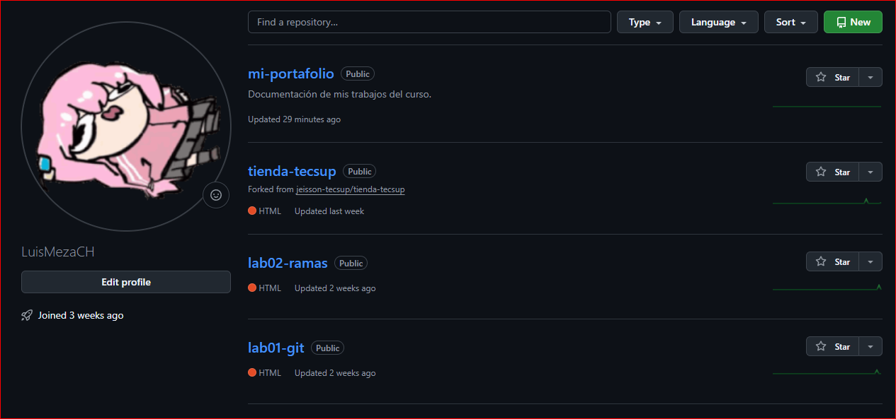

# Mi portafolio

Trabajos del curso de Diseño de Interfaces de Programación Avanzado.

## Sobre mi

Estudiante de Diseño y Desarrollo de Software en Tecsup.

## Contenido
### Trabajos del modulo 

## Herramientas que uso

- **Git** para control de versiones
- ***Github*** para el repositorio remoto
- *Visual Studio Code* como editor

## Pasos para clonar este proyecto

1. Copiar la dirección desde el botón code
2. Ejecutar git clone con esa dirección
3. Entra a la carpeta con cd

## Mi avance del modulo

- [x] Laboratorio 01: Git basico
- [x] Laboratorio 03: Trabajo colaborativo
- [ ] Laboratorio 04: Markdown

## Enlaces utiles

- [Guia oficial de Markdown](https://www.markdownguide.org/)
- [Mi perfil de GitHub](https://github.com/LuisMezaCH)

## Captura de mis trabajos



## Guia de mis trabajos

- [tienda-tecsup](docs/GUIA.md)

## Comandos que más uso

Para ver el estado del proyecto uso `git status`.

````bash
git add .
git commit -m "Actualiza el README"
git push origin main
````
| Comando | Que hace |
|---------|----------|
| git add | Prepara los cambios |
| git commit | Guarda la version |
| git push | Sube los cambios al remoto |

> Documentar es parte del trabajo, no un extra al final.