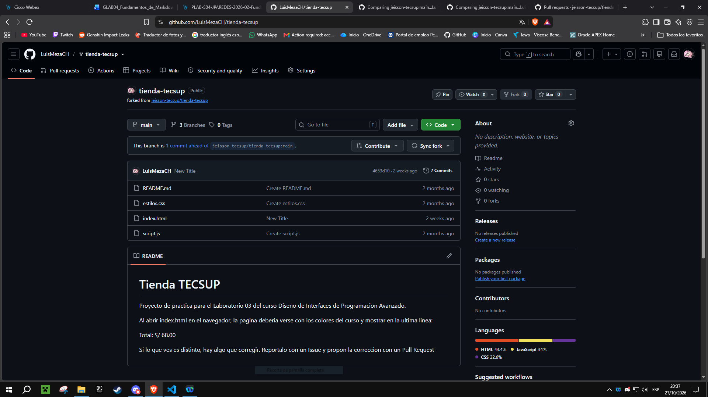

# Guia del Laboratorio "tienda-tecsup"

Proyecto de practica para el Laboratorio 03 del curso Diseno de Interfaces de Programacion Avanzado.

Al abrir index.html en el navegador, la pagina deberia verse con los colores del curso y mostrar en la ultima linea:

- Total: S/ 68.00

- Sin estilos


## Errores corregidos

- ### script.js

    1. El total sumaba el precio una sola vez, sin multiplicarlo por la cantidad.
    2. En la **línea #9**, a la formula le faltaba multiplicar con **producto.cantidad**.
    3. Se crea la rama **fix-entire-cart** y se corrigió la formula.
    4. Se uso **git add y git commit** para preparar y guardar los cambios.
    5. Por ultimo, **git push** para subir los cambios a Github.

- ### index.html
    1. Al cargar la pagina se podia visualizar que no cargaban los estilos y tablas.
    2. En la **línea #6**, la referencia está mal escrita y por ello no cargan los estilos en la pagina.
    3. Se crea la rama **fix-page-style** y se cambia la referencia por **href="estilos.css"**.
    4. Se uso **git add y git commit** para preparar y guardar los cambios.
    5. Por ultimo, **git push origin main** para subir los cambios a Github.

## Avance de correcciones y pendientes

- [x] Correct the calculation of the cart total
- [x] Fix page style
- [ ] Add a dark mode to the page

## Enlaces utiles

- [Mi perfil de GitHub](https://github.com/LuisMezaCH)
- [tienda-tecsup](https://github.com/LuisMezaCH/tienda-tecsup)

## Captura del trabajo



## Comandos más usados

````bash
git add .
git commit -m 
git push origin main
````

| Comando | Que hace |
|---------|----------|
| git add | Prepara los cambios |
| git commit | Guarda la version |
| git push | Sube los cambios al remoto |

> Fin.